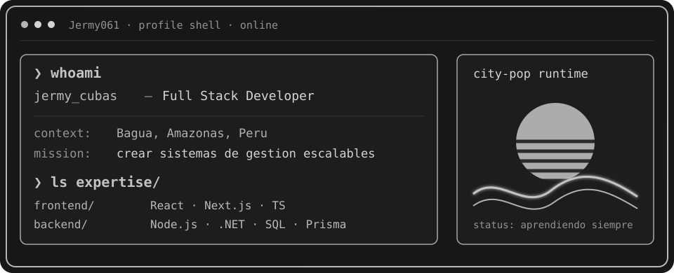

<div align="center">

<a href="https://github.com/Jermy061">
  <picture>
    <source media="(prefers-color-scheme: dark)" srcset="assets/banner-dark.v9.svg">
    <source media="(prefers-color-scheme: light)" srcset="assets/banner-light.v9.svg">
    
  </picture>
</a>

<br>

<a href="https://github.com/Jermy061">
  
</a>

<br>


</div>

---

## `$ whoami`

<p align="center">
  
</p>

<p align="center"><sub><code>Ingeniería de Sistemas · UNTRM · VIII ciclo · Tercio Superior</code></sub></p>

<div align="center">

## `$ cat tech-stack.yaml`

<table border="1" cellpadding="14" bgcolor="#17171c">
<thead><tr><th colspan="2" align="left"><code>jermy@bagua:~$ cat tech-stack.yaml</code></th></tr></thead>
<tbody>
<tr>
<td width="50%" valign="top"><code>├─ ◆ frontend:</code><br><br><br><sub><code>TypeScript · React · Next.js · Tailwind</code></sub></td>
<td width="50%" valign="top"><code>├─ ▣ databases:</code><br><br><br><sub><code>PostgreSQL · MySQL · Prisma · Neon · Aiven</code></sub></td>
</tr>
<tr>
<td valign="top"><code>├─ ⚙ backend:</code><br><br><br><sub><code>Node.js · Express · C# · .NET</code></sub></td>
<td valign="top"><code>├─ ◉ payments_hosting:</code><br><br>  <br><sub><code>Stripe · Mercado Pago · Vercel · Neon</code></sub></td>
</tr>
<tr>
<td valign="top"><code>├─ ✦ other_languages:</code><br><br><br><sub><code>PHP · Python · Flutter</code></sub></td>
<td valign="top"><code>╰─ ⌁ quality_devops:</code><br><br> <br><sub><code>Docker · Git · SonarQube · Grafana</code></sub></td>
</tr>
</tbody><tfoot><tr><td colspan="2"><code>status: en formación · environment: production</code></td></tr></tfoot>
</table>

</div>

---

## `$ kubectl get signals --all-namespaces`

<p align="center">
  <picture><source media="(prefers-color-scheme: dark)" srcset="assets/radar-dark.svg"><source media="(prefers-color-scheme: light)" srcset="assets/radar-light.svg"></picture>&nbsp;
  <picture><source media="(prefers-color-scheme: dark)" srcset="assets/radar-langs-dark.svg"><source media="(prefers-color-scheme: light)" srcset="assets/radar-langs-light.svg"></picture>
</p>

<p align="center"><sub><code>signals: fullstack_skill_radar · language_stack_radar · status: learning</code></sub></p>
<p align="center"><sub>Radares orientativos de autoevaluación, no métricas oficiales de GitHub.</sub></p>

---

## `$ ls proyectos/`

| Proyecto | Qué construí | Tecnologías |
|:--|:--|:--|
| [SIGETRAM Bagua](https://github.com/Jermy061/sgd-bagua) | Digitalización y trazabilidad de trámites municipales. Proyecto de tres integrantes; aportes funcionales, seguridad y administración. | Next.js · TypeScript · Tailwind · PostgreSQL · Prisma · Neon · Auth.js |
| [Transporte](https://github.com/Jermy061/Transporte) | Pasajes, encomiendas, caja, inventario, clientes y pagos en línea. | TypeScript · Stripe · Mercado Pago · Aiven · Vercel |
| [ASP Levanto](https://github.com/Jermy061/ASP_Levanto) | Gestión de socios y leche, ventas, entregas, reportes, tienda y landing pública. | TypeScript · Tailwind · GSAP · Lenis · pnpm · Vercel |
| [VetCare](https://github.com/Jermy061/vetcare) | Historias clínicas, citas, vacunación, recetas, adjuntos, auditoría, reportes y notificaciones. | TypeScript · React · Tailwind |
| [Taller mecánico](https://github.com/Jermy061/taller-mecanico) | Operaciones, panel administrativo, reportes y web pública configurable. | TypeScript |
| [Levanto Tur](https://github.com/Jermy061/LEVANTO_TUR) | Sistema turístico para el circuito de Levanto, Amazonas. | TypeScript |
| [Restobar (colaboración)](https://github.com/TrzJhonDev/restobar-proyect) | Plataforma multi-tenant para restaurantes y bares con roles; equipo de cuatro. | TypeScript · Node.js · Express · Prisma · MySQL · React · Vite · Tailwind · Docker |

---

## `$ tail -f actividad.log`

<p align="center"></p>

<p align="center"><sub><code>activity: commits · pull requests · proyectos</code></sub></p>

---

## `$ cat formacion.txt`

```text
Ingeniería de Sistemas · UNTRM · VIII ciclo · Tercio Superior
Angular: de cero a experto · Udemy
Software Development with Claude Code · DataCamp
```

---

## `$ connect --socials`

<div align="center">
<a href="https://linkedin.com/in/jermy-sneyder-cubas-solsol-54890a238"></a>&nbsp;&nbsp;
<a href="mailto:jermysneydercubassolsol@gmail.com"></a>&nbsp;&nbsp;
<a href="https://github.com/Jermy061"></a>
</div>

<br>
<div align="center"><sub>Hecho desde Bagua, Amazonas, Perú · @Jermy061 🌸</sub></div>
