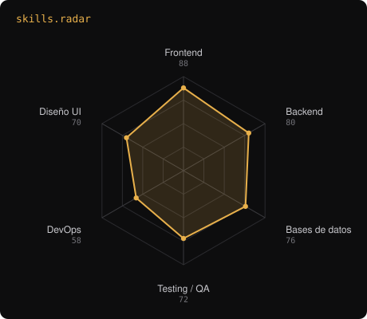
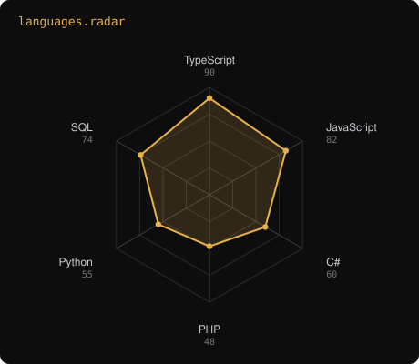

[](https://github.com/Jermy061)

---

## `$ whoami`

```
jermy@bagua:~$ whoami
Jermy Sneyder Cubas Solsol · Full Stack Developer · Bagua, Amazonas, Perú

jermy@bagua:~$ cat perfil.txt
Construyo sistemas de gestión para negocios y entidades de mi región:
trámites municipales, transporte, lácteos, veterinaria, talleres.
Multi-tenant, con pagos integrados y paneles administrativos.

jermy@bagua:~$ cat estudios.txt
Ingeniería de Sistemas · UNTRM · VIII ciclo · Tercio Superior
```

[](https://linkedin.com/in/jermy-sneyder-cubas-solsol-54890a238)
[](mailto:jermysneydercubassolsol@gmail.com)

---

## `$ cat stack.yaml`

| `jermy@bagua:~$ cat stack.yaml` | |
|---|---|
| `├─ ◆ frontend:`  `TypeScript · React · Next.js · Tailwind` | `├─ ▣ datos:`  `PostgreSQL · MySQL · Prisma` |
| `├─ ⚙ backend:`  `Node.js · Express · C# · .NET` | `├─ ◉ pagos_servicios:`  `Stripe · Mercado Pago · Vercel · Neon` |
| `├─ ✦ otros_lenguajes:`  `PHP · Python · Flutter` | `╰─ ⌁ calidad_devops:`  `Docker · Git · SonarQube · Grafana` |

`status: en formación · environment: production`

---

## `$ get signals --all`



`signals: skills_radar · language_radar`

---

## `$ ls proyectos/`

**[sgd-bagua](https://github.com/Jermy061/sgd-bagua) — SIGETRAM Bagua**
Digitalización y trazabilidad de trámites documentarios de la Municipalidad Provincial de Bagua. Arquitectura monolítica modular, desarrollada en equipo de tres con integración por Pull Requests. Aporté módulos funcionales, mejoras de seguridad y funcionalidades administrativas.
`Next.js` · `TypeScript` · `Tailwind CSS` · `PostgreSQL` · `Prisma` · `Neon` · `Auth.js`

**[Transporte](https://github.com/Jermy061/Transporte)**
Sistema para empresa de transporte: venta de pasajes, encomiendas, caja, inventario y clientes, con cobros en línea mediante Stripe Checkout y Mercado Pago.
`TypeScript` · `Stripe` · `Mercado Pago` · `Aiven` · `Vercel`

**[ASP_Levanto](https://github.com/Jermy061/ASP_Levanto)**
Sistema para una asociación procesadora de lácteos. Panel administrativo para el registro de socios proveedores y la leche que entregan, además de ventas, entregas y reportes con filtros y paginación. Incluye tienda en línea y landing page públicas.
`TypeScript` · `Tailwind CSS` · `GSAP` · `Lenis` · `pnpm` · `Vercel`

**[vetcare](https://github.com/Jermy061/vetcare)**
Gestión veterinaria: historias clínicas con línea de tiempo, consultas, citas, vacunación y refuerzos, recetas, adjuntos privados, reportes, auditoría exportable y notificaciones.
`TypeScript` · `React` · `Tailwind CSS`

**[taller-mecanico](https://github.com/Jermy061/taller-mecanico)**
Sistema para taller mecánico: operaciones del taller, panel administrativo, reportes y sitio web público configurable desde el panel.
`TypeScript`

**[LEVANTO_TUR](https://github.com/Jermy061/LEVANTO_TUR)**
Sistema de turismo para el circuito de Levanto, Amazonas.
`TypeScript`

**[restobar-proyect](https://github.com/TrzJhonDev/restobar-proyect)** — colaboración
Sistema integral para restaurantes y bares, multi-tenant y con control de accesos por roles. Monorepo con backend y frontend separados, desarrollado en equipo de cuatro.
`TypeScript` · `Node.js` · `Express` · `Prisma` · `MySQL` · `React` · `Vite` · `Tailwind CSS` · `Docker`

---

## `$ tail -f actividad.log`


---

## `$ cat formacion.txt`

- **Ingeniería de Sistemas** — UNTRM, VIII ciclo · Tercio Superior
- Angular: de cero a experto — Udemy
- Software Development with Claude Code — DataCamp

---

`Hecho desde Bagua, Amazonas · @Jermy061`
